# Liveside

A Twitch chat client for Linux, for viewers, moderators and broadcasters.

**One engine, a window and a terminal. Careful with what strangers post, and with your data.**

<table>
  <tr>
    <td width="50%">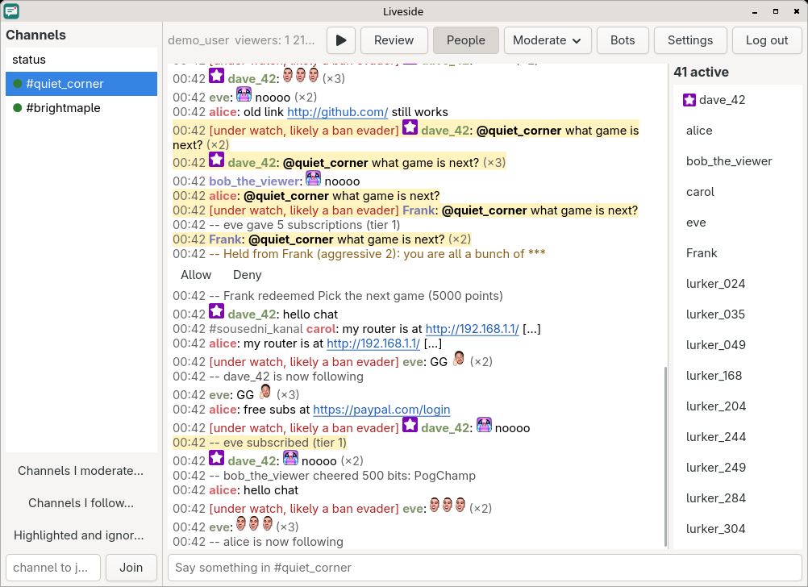</td>
    <td width="50%">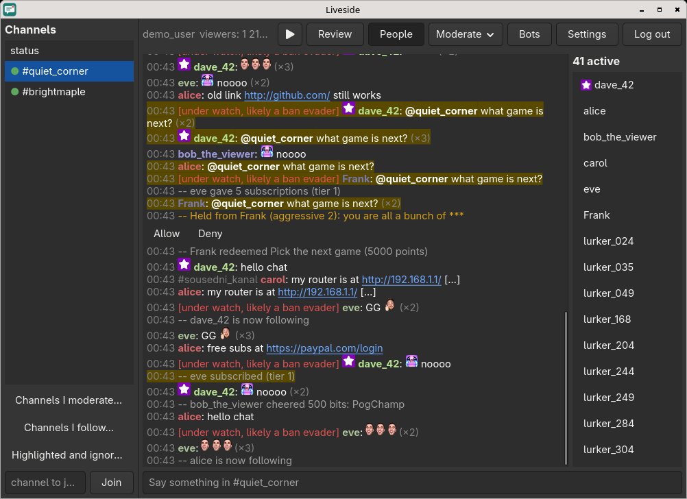</td>
  </tr>
  <tr>
    <td>The window, light…</td>
    <td>…and dark.</td>
  </tr>
</table>

<table>
  <tr>
    <td width="50%">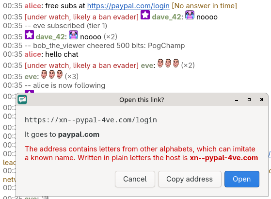</td>
    <td width="50%">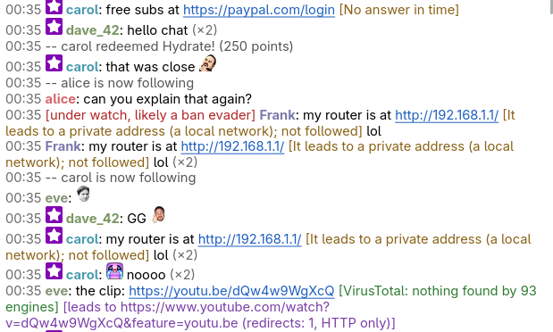</td>
  </tr>
  <tr>
    <td>A look-alike address is shown as it really is before it opens.</td>
    <td>Where a link leads and what VirusTotal says, without opening it.</td>
  </tr>
  <tr>
    <td>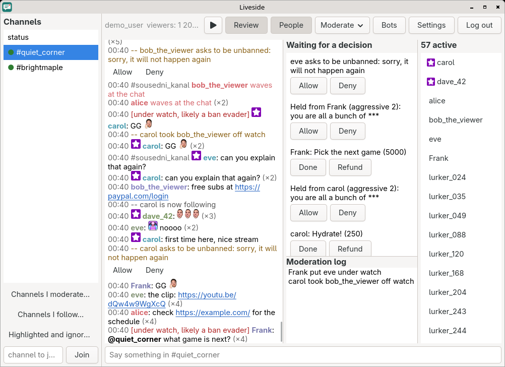</td>
    <td>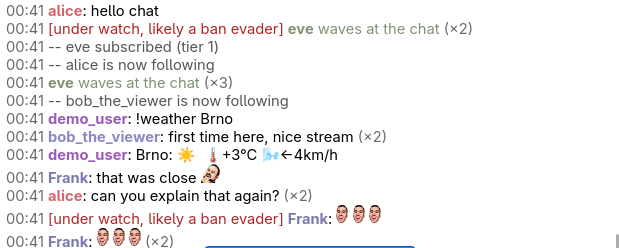</td>
  </tr>
  <tr>
    <td>What waits for a moderator: AutoMod, unban requests, rewards.</td>
    <td>A bot of your own answering in the chat.</td>
  </tr>
</table>

<details>
<summary>More screenshots: menus, settings, the terminal</summary>

<p>
  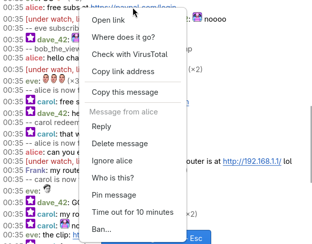
  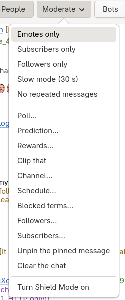
</p>
<p>
  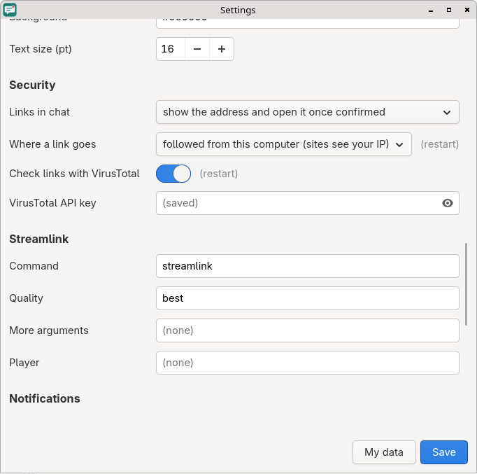
  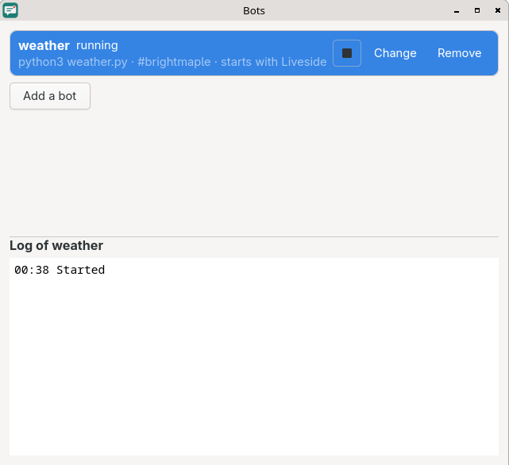
</p>
<p>
  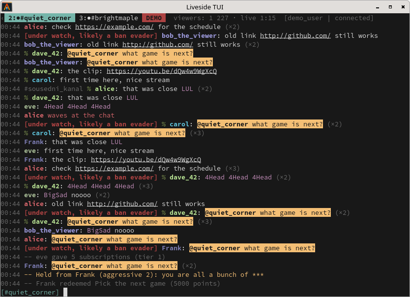
  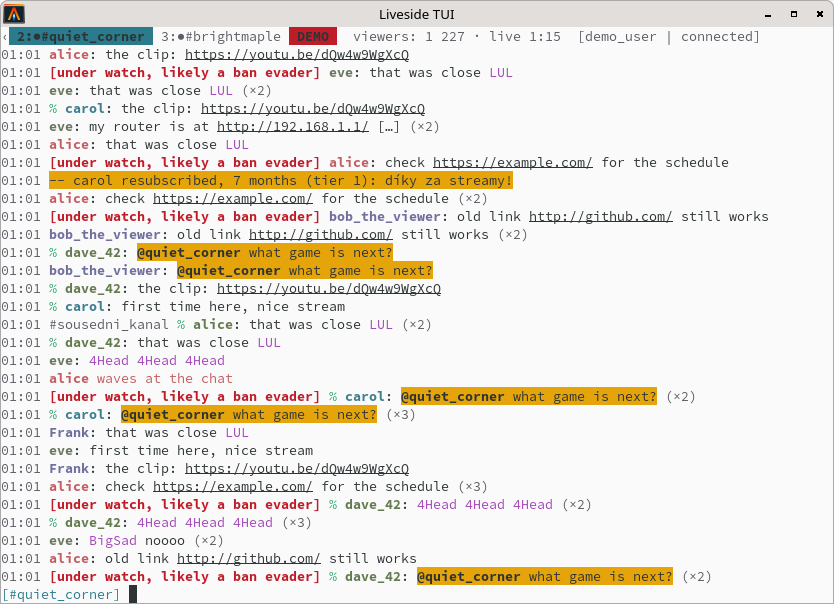
</p>
<p>
  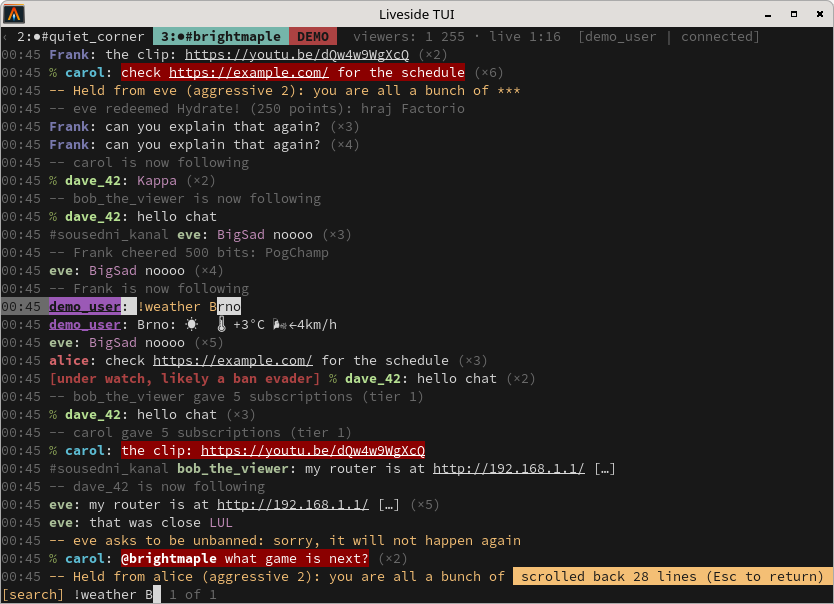
  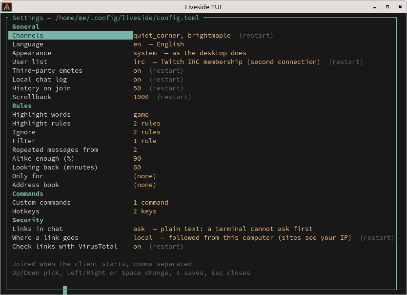
</p>

</details>

Screenshots from the demo mode, with made-up channels and people.

## Why

[Chatty](https://github.com/chatty/chatty) has long been a favourite
desktop client for reading and moderating Twitch chat. Liveside started as a
rewrite of what it does, from scratch and in Rust, on Twitch's current
interfaces (EventSub and Helix), and keeps Chatty's rule language, so
highlight and ignore lists carry over.

It adds what a chat window kept open through a whole stream needs today:
the broadcaster's own tools beside the chat, a terminal frontend that
works over SSH, and an engine that can run on as a background service
while frontends come and go.

Security and privacy are the other reason it exists, and were part of
the plan from the start rather than added later. A chat client shows
text from strangers all day, to people who are easy to find: chat is
where moderators get phished and where streamers get sent links that
log their IP address. So Liveside treats everything in chat as
untrusted, keeps the login out of reach of what it does not need it,
and sends nothing about you anywhere the chat does not need it to go.

## Where it runs

Liveside needs GTK 4.10 or newer. The Flatpak brings its own.

| Desktop | Tried |
|---|---|
| labwc (Wayland) | Arch Linux, the development machine |
| KDE Plasma 6.8 (Wayland) | Arch Linux, the Flatpak |
| GNOME 50 (Wayland) | Ubuntu 26.04, the Flatpak and a build from source |
| Cinnamon 6.6 (X11) | Linux Mint 22.3, the Flatpak and a build from source |
| COSMIC 1.10 (Wayland) | CachyOS, the Flatpak and a build from source |
| Xfce 4.20 (X11) | Debian 13, a build from source |
| Windows 11 | through WSL2, with Debian 13 inside |

On macOS it builds with Homebrew and runs, but notifications do not work
there yet.

## What it does

- **Chat.**
  - Several channels at once, side by side or in windows of their own.
  - Emotes from Twitch, 7TV, BetterTTV and FrankerFaceZ, animated ones
    included, and each channel's own badges.
  - Replies, mentions, search, whispers in threads of their own, and
    Shared Chat.
  - A local chat log, so a channel you rejoin comes back with its
    recent lines.
- **Your own rules.** Highlight, ignore and filter rules in Chatty's
  syntax, an address book, custom commands, hotkeys, and marking what
  somebody keeps repeating.
- **Moderation.**
  - Timeouts, bans, warnings, deleting, the room's modes, moderators and
    VIPs, pinned messages, Shield Mode, blocked terms and suspicious
    users.
  - AutoMod's queue, unban requests and the moderation log in one Review
    panel.
- **For broadcasters.**
  - Polls, predictions, and channel point rewards with their queue.
  - The channel's title, category, tags and schedule.
  - Raids, shoutouts, markers, ad breaks and clips.
  - Follows, subscriptions, bits, Hype Trains and charity in the chat,
    and a graph of viewers over the stream.
- **Notifications** for mentions, whispers, channels going live and
  messages waiting for a moderator, with sounds.
- **Streamlink** to watch the stream, and a Stream Chat window to show
  the chat in a broadcast.
- **Bots of your own.** Programs Liveside starts and talks to, which need
  no login of their own ([docs/bots.md](docs/bots.md)).
- **Languages.** English and Czech, and machine translations into
  Spanish, Russian, Ukrainian, Esperanto, Greek, Korean, Japanese,
  Chinese, Thai, Vietnamese and Arabic.

### Safety and privacy

- **Links are untrusted.**
  - A link opens only after you have seen its whole address, with the
    host emphasized. A host with a look-alike letter in it is shown in
    punycode as well (`xn--…`), so the trick is visible.
  - Where a link leads can be found out without opening it: Liveside
    follows its redirects, never renders the page, and never goes to a
    private address in your own network. The settings say plainly that
    the sites on the way see your IP address, which an IP logger is
    made for. It is off until you switch it on.
  - VirusTotal can be asked about a link you pick, with your own key.
    Nothing is checked or sent by itself.
- **Your login is kept close.**
  - Liveside logs in with a code entered at twitch.tv/activate, so it
    never sees your password.
  - The login is a token in a file only you can read, and your own bots
    never get it: Liveside speaks for them.
- **Nothing about you goes anywhere it need not.** Chat goes to Twitch.
  The emote providers are asked which emotes a channel has, which tells
  them the channels you read; that can be switched off, and so can the
  local chat log. There is no telemetry, no crash reporting and no
  update check.
- **You can check all of this.** `/privacy` lists what is sent where
  and what is stored, from the settings in use, and
  [docs/privacy.md](docs/privacy.md) has the full list and how to
  verify it yourself.
- **Moderators get help against ban evaders** from Twitch's suspicious
  users, marked in the chat.

## Installing

On Arch Linux, install [`liveside`](https://aur.archlinux.org/packages/liveside)
from the AUR; its PKGBUILD is kept in
[foxkyong/aur-liveside](https://github.com/foxkyong/aur-liveside). The
package also installs the launcher entry, the icon, the daemon's user
service and the example bot.

Elsewhere, take the Flatpak bundle from the
[latest release](https://github.com/foxkyong/liveside/releases/latest)
and install it with `flatpak install --user liveside-*.flatpak`; it runs
on the GNOME 51 runtime, which Flatpak fetches from Flathub. The Flatpak
can also be built from `packaging/flatpak/` (how is at the top of its
manifest).

### From source

You need Rust 1.98 or newer (from [rustup](https://rustup.rs); most
distributions carry an older one) and GTK 4 for development:

| Distribution | Package |
|---|---|
| Debian 13, Ubuntu 24.04 and newer | `libgtk-4-dev` |
| Fedora | `gtk4-devel` |
| Arch Linux | `gtk4` |

```sh
cargo build --release
```

The programs are then in `target/release/`: `liveside-gui`, `liveside-tui`
and `liveside-daemon`.

## First steps

1. Start `liveside-gui`, or `liveside-tui` in a terminal.
2. Press **Log in** (in the terminal, type `/login`) and enter the code
   it shows at twitch.tv/activate.
3. Type a channel's name in the field under the channel list and press
   **Join** (in the terminal, `/join name`).

To look around without a Twitch account, start it with `--demo`: any
channel you join then has a made-up chat.

[docs/usage.md](docs/usage.md) has the keys, the commands, every setting
and the daemon.

### The terminal and the daemon

`liveside-tui` does what the window does, in a terminal and over SSH.
`liveside-daemon` keeps the chat running without a frontend; start the
window or the terminal with `--daemon` to attach to it, and several can
be attached at once. A systemd user service for it is in
`packaging/linux/`.

## Limitations

- Twitch only, and one account at a time.
- Linux only. Windows works through WSL2, without notifications
  ([docs/usage.md](docs/usage.md#windows-through-wsl2) says what to set
  up there); macOS builds, but has no notifications either.
- Global hotkeys, while the window is not focused, are not possible on
  Wayland, which gives them to the desktop.
- Translations other than English and Czech are made by a machine and
  wait for someone to check them.
- Guest Star waits until Twitch's interface for it leaves beta.

## Building and developing

```sh
cargo test
cargo run -p liveside-gui -- --demo
```

| Path | What |
|---|---|
| `crates/proto` | Commands, events and the data model shared by everything |
| `crates/twitch` | Twitch's login, EventSub, Helix and the emote providers |
| `crates/core` | The engine |
| `crates/client` | What frontends use, in one process or attached to the daemon |
| `crates/gui`, `crates/tui`, `crates/daemon` | The programs |
| `docs/architecture.md` | The design and the decisions behind it |
| `docs/roadmap.md` | What is left to build |
| `docs/chatty-features.md` | Chatty's features and which of them Liveside has |

What changed in each version is in [CHANGELOG.md](CHANGELOG.md).

## Written with an AI

Most of Liveside's code and documentation was written by Claude, an AI
made by Anthropic, working with the author: the author decides what
Liveside does and how, and it is tried in use on the desktops listed
above. The design and the reasons behind it are in
[docs/architecture.md](docs/architecture.md).

## License

[GPL-3.0-or-later](LICENSE), © Radim Vančo (FoxKyong). Whoever passes
Liveside on, changed or not, passes on its source under the same terms.

Contributions are welcome under the same licence: by sending one, you
license it under GPL-3.0-or-later. There is no contributor agreement to
sign.
